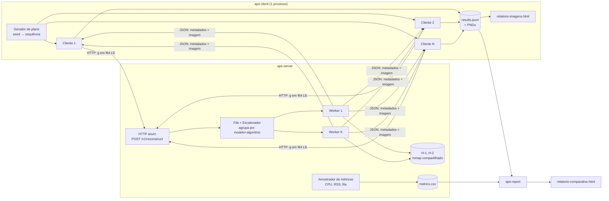
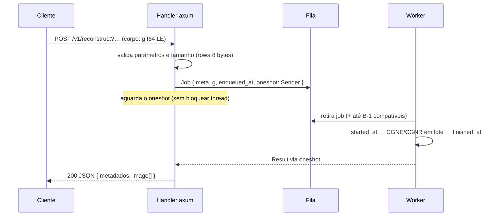

# Arquitetura — Reconstrução de Imagens (APS semestral)

Sistema cliente/servidor para reconstrução de imagens de ultrassom a partir de sinais `g` e matrizes de modelo `H`, usando os algoritmos **CGNE** e **CGNR**. Implementação **compilada e fortemente tipada em Rust** (servidor, cliente e gerador de relatórios).

> Documentos relacionados: [`specs.md`](specs.md) (o que o sistema faz, contrato HTTP, fórmulas) e [`plano.md`](plano.md) (fases de implementação).

---

## 1. Decisões principais

| Decisão | Escolha | Motivo |
|---|---|---|
| Linguagem | **Rust** | Compilada, fortemente tipada, sem GC, álgebra linear com SIMD e concorrência segura. |
| Protocolo | **HTTP/1.1 com corpo binário** (`application/octet-stream`, f64 little-endian) | O tempo de transporte (~1 ms por sinal) é desprezível perto da reconstrução (~1 s); HTTP é simples de depurar (`curl`) e de reimplementar em qualquer linguagem. |
| Escolha do algoritmo | **Por requisição** (`algorithm=cgne\|cgnr`) | Permite enviar a mesma sequência de sinais para CGNE e CGNR (requisito 6 do cliente) sem reiniciar o servidor. |
| Reprodutibilidade | **Semente fixa** no cliente | Ganho, modelo, sinal e intervalos são gerados a partir de `--seed`, então a sequência é idêntica nas duas execuções. |
| Armazenamento de `H` | **Binário pré-convertido + `mmap`**, densa, coluna-major | O CSV de 680 MB leva dezenas de segundos para parsear; o binário mapeado em memória carrega instantaneamente e é compartilhado entre threads sem cópia. |
| Representação | **Densa** | O `H-2` tem ~25% de não-zeros; com essa densidade, CSR economiza pouco e perde o SIMD/blocking da multiplicação densa. |
| Relatórios | **HTML autocontido** | Imagens PNG e gráficos SVG embutidos; abre no navegador e imprime em PDF. |

---

## 2. Visão geral



Componentes:

1. **`aps-client`**: simula N ≥ 3 clientes simultâneos (tasks tokio). Cada um envia ≥ 15 sinais em intervalos aleatórios, aplica o ganho localmente e grava os resultados.
2. **`aps-server`**: recebe os sinais, enfileira, reconstrói com CGNE/CGNR e devolve a imagem com os metadados. Também amostra CPU, memória e tamanho da fila.
3. **`aps-report`**: junta os resultados do cliente e as métricas do servidor e gera o relatório comparativo (CGNE vs CGNR).
4. **`aps-tools prepare`**: converte os CSVs de `H` (dentro dos `.zip`) para o formato binário uma única vez.

---

## 3. Estrutura do workspace Cargo

```
aps-reconstrucao/
├── Cargo.toml                 # [workspace]
├── data/                      # CSVs originais (não versionar os .zip grandes)
├── cache/                     # H-1.bin, H-2.bin, c-*.json (gerados)
├── crates/
│   ├── aps-core/              # biblioteca: álgebra, algoritmos, ganho, modelos
│   │   └── src/{lib.rs, model.rs, matrix.rs, cgne.rs, cgnr.rs, gain.rs, image.rs}
│   ├── aps-protocol/          # tipos compartilhados do contrato HTTP (serde)
│   ├── aps-server/            # binário: axum + fila + workers + métricas
│   ├── aps-client/            # binário: simulador de clientes + relatório de imagens
│   ├── aps-report/            # binário: relatório comparativo HTML
│   └── aps-tools/             # binário: prepare (CSV → bin), bench, validação
└── runs/                      # saídas de cada execução (gerado)
```

Dependências planejadas (versões estáveis atuais no momento da implementação):

| Crate | Uso |
|---|---|
| `tokio` | runtime assíncrono (rede, timers, tasks de cliente) |
| `axum` | servidor HTTP |
| `reqwest` | cliente HTTP |
| `faer` | álgebra linear densa (matvec/matmul paralelos com SIMD) |
| `memmap2` | mapear `H-*.bin` em memória |
| `bytemuck` | reinterpretar `&[u8]` ↔ `&[f64]` sem cópia |
| `serde`, `serde_json` | metadados e JSONL |
| `rand`, `rand_chacha` | RNG com semente reproduzível |
| `clap` | CLI dos binários |
| `sysinfo` | CPU% e RSS do processo |
| `plotters` (backend SVG) | gráficos do relatório |
| `image`, `base64` | PNG das reconstruções embutido no HTML |
| `chrono` | timestamps RFC 3339 com milissegundos |
| `tracing`, `tracing-subscriber` | logs |
| `zip`, `csv` | apenas em `aps-tools prepare` |

---

## 4. Dados e modelos

| Modelo | Arquivo H | Dimensão de H | Imagem | S × N (hipótese) | Sinais disponíveis |
|---|---|---|---|---|---|
| `60x60` | `H-1.csv.zip` | 50816 × 3600 | 60 × 60 | 794 × 64 | `G-1.csv`, `G-2.csv`, `A-60x60-1.csv` |
| `30x30` | `H-2.csv.zip` | 27904 × 900 | 30 × 30 | 436 × 64 | `g-30x30-1.csv`, `g-30x30-2.csv`, `A-30x30-1.csv` |

Memória de `H` em f64: **~1,46 GB** (`H-1`) + **~0,20 GB** (`H-2`). A máquina de desenvolvimento tem 16 núcleos e 15 GB de RAM.

### 4.1 Formato binário (`cache/H-<n>.bin`)

```
offset 0   : magic   b"APSH"            (4 bytes)
offset 4   : version u32 LE = 1
offset 8   : rows    u64 LE
offset 16  : cols    u64 LE
offset 24  : dtype   u32 LE (0 = f64, 1 = f32)
offset 28  : padding até 64 bytes
offset 64  : dados, coluna-major, little-endian
```

Coluna-major porque é o layout nativo do `faer`: o servidor cria uma `MatRef` direto sobre o slice mapeado, sem cópia. O `mmap` é compartilhado entre todos os workers via `Arc<Model>`.

### 4.2 Constantes pré-computadas por modelo

- **c = ‖HᵀH‖₂** (fator de redução): calculado por iteração de potência no `prepare` e salvo em `cache/c-<modelo>.json`. Custa algumas dezenas de matvecs, então é calculado uma vez só e nunca por requisição.

---

## 5. Servidor (`aps-server`)

### 5.1 Fluxo de uma requisição



A requisição HTTP fica aberta até a imagem ficar pronta. Isso é simples, e o cliente envia cada sinal numa task separada, então não precisa esperar uma resposta para mandar o próximo. Assim a fila do servidor de fato se forma, o que é necessário para medir a média e a moda da fila.

### 5.2 Fila e escalonador

- Uma única fila FIFO (`Mutex<VecDeque<Job>>` + `Condvar`/`Notify`) com capacidade configurável. Se estiver cheia, a resposta é `503`.
- `queue_len` fica num `AtomicUsize`, lido pelo amostrador de métricas.
- **Batching:** ao retirar o job da frente, o worker também retira até `B-1` jobs já enfileirados com a **mesma chave `(modelo, algoritmo)`**. Pode esperar até `batch_window_ms` para completar o lote. Com `B = 1`, o batching fica desligado e o servidor é FIFO puro.

### 5.3 Workers e paralelismo

O gargalo é a **banda de memória**: cada iteração lê `H` inteira duas vezes (`H·p` e `Hᵀ·r`). Duas alavancas:

1. **Paralelismo dentro da multiplicação:** o `faer` divide a matvec/matmul entre `T` threads.
2. **Batching:** com `k` sinais no lote, `H·[p₁ … p_k]` vira uma matriz × matriz. `H` é lida **uma vez** para os `k` sinais, então o custo por imagem cai quase `k` vezes enquanto o processamento for limitado pela memória.

Configuração: `K` workers (threads de SO dedicadas, fora do runtime tokio) × `T` threads cada, com `K·T ≈ núcleos`. Os valores ideais de `K`, `T` e `B` serão medidos na fase de otimização (ver `plano.md`).

Num lote, cada sinal tem seus próprios escalares (`αᵢ`, `βᵢ`) e critério de parada. Quando um sinal converge, a coluna dele sai do lote (compactação) e o resultado é devolvido imediatamente, sem esperar os demais.

### 5.4 Precisão

Padrão **f64**. Flag experimental `--precision f32` (exige `H` convertida para f32 no `prepare`): metade dos bytes lidos, quase 2× mais rápido. Só será adotada se a imagem e o número de iterações forem equivalentes aos de f64.

### 5.5 Métricas

Uma task tokio amostra a cada `--metrics-interval-ms` (padrão 100 ms) e escreve em `runs/server-<timestamp>/metrics.csv`:

```
ts_ms, cpu_percent, rss_bytes, queue_len, in_progress, completed_total
```

- `cpu_percent` vem do `sysinfo` para o próprio processo (0–100 × núcleos). O relatório mostra também o valor normalizado (÷ núcleos).
- `queue_len` são os jobs aguardando, sem contar os que estão em processamento.
- O relatório recorta as métricas pela janela `[início, fim]` de cada execução, que o cliente registra.

---

## 6. Cliente (`aps-client`)

1. **Plano:** a partir de `--seed`, gera para cada cliente `k` e sinal `j`: modelo, arquivo-base, se aplica ganho e intervalo até o próximo envio. Salva em `plan.json` (auditável e reutilizável com `--plan`).
2. **Execução:** cada cliente é uma task tokio. Ela dorme o intervalo, carrega o sinal-base (cache em memória por arquivo), aplica o ganho γ e dispara o envio numa **task separada** (não espera a resposta para o próximo).
3. **Modo `--algorithm both`:** executa o plano inteiro com `cgne`, espera todas as respostas e executa **o mesmo plano** com `cgnr`. As fases são sequenciais para as métricas de CPU e memória de um algoritmo não se misturarem com as do outro.
4. **Saídas** em `runs/<run_id>/<algoritmo>/`:
   - `results.jsonl`: uma linha por imagem (metadados completos da resposta, sem o vetor);
   - `images/<cliente>-<sinal>.png`;
   - `window.json`: horário de início e fim da fase;
   - `relatorio-imagens.html`: todas as imagens com cliente, sinal, algoritmo, início, fim e iterações.

---

## 7. Relatório comparativo (`aps-report`)

Entrada: diretórios de execução (`runs/<id>/cgne`, `runs/<id>/cgnr`) e o `metrics.csv` do servidor. Saída: `relatorio-comparativo.html` com uma coluna por execução:

1. Número total de imagens reconstruídas
2. Tempo total de execução (do primeiro envio à última resposta)
3. Gráfico de CPU × tempo
4. Gráfico de memória (RSS) × tempo
5. Média do tamanho da fila (amostras periódicas)
6. Moda do tamanho da fila
7. Tempo médio de reconstrução (`finished_at − started_at`)
8. Extras: tempo médio na fila, média de iterações, % de sinais que convergiram por ε, imagens por segundo

O relatório lê qualquer diretório que siga o mesmo formato. Se outra implementação de servidor (por exemplo, uma versão interpretada) gravar resultados e métricas nesses formatos, ela entra na comparação sem mudar o código.

---

## 8. Tratamento de erros

| Situação | Comportamento |
|---|---|
| Parâmetro inválido / modelo desconhecido | `400` + JSON `{ "error": "..." }` |
| Corpo com tamanho ≠ `rows × 8` | `400` |
| Fila cheia | `503` (o cliente registra a falha e segue) |
| NaN/Inf durante a iteração (ex.: `pᵀp = 0`) | interrompe o sinal, devolve `200` com `stop_reason = "breakdown"` |
| `H` ausente no cache ao subir | o servidor não sobe; a mensagem indica rodar `aps-tools prepare` |
